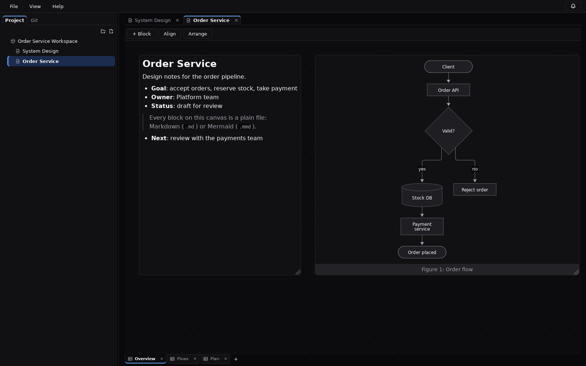
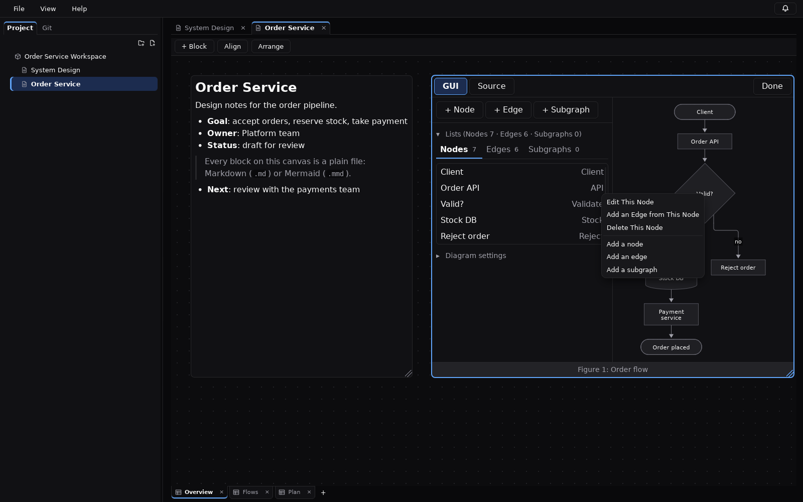
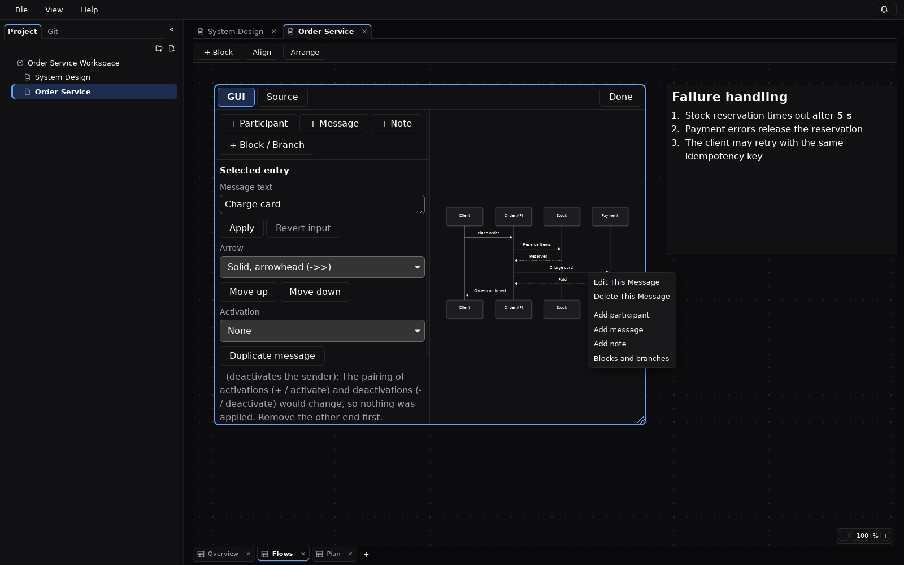
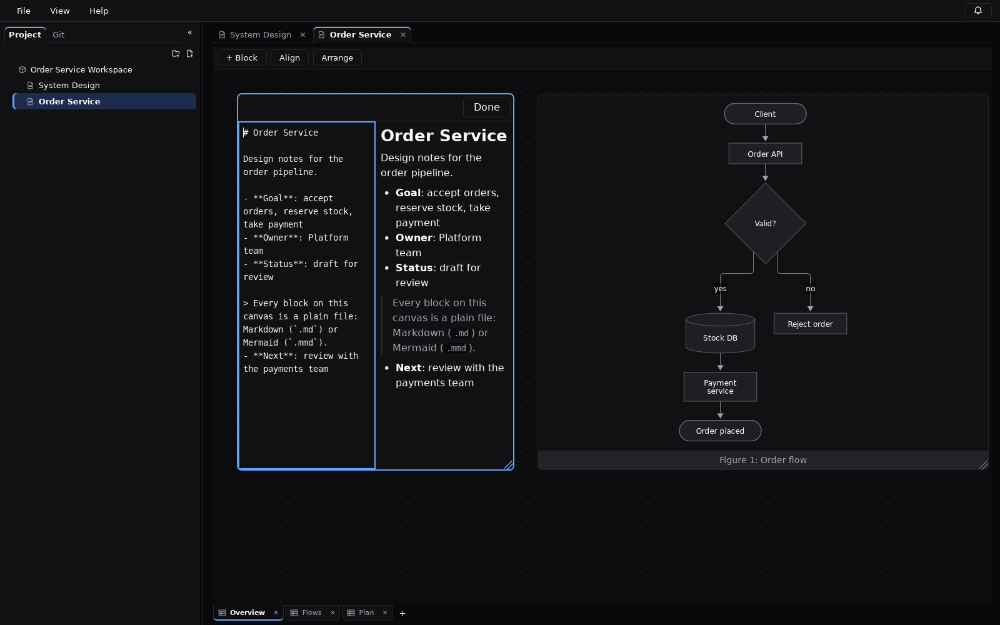
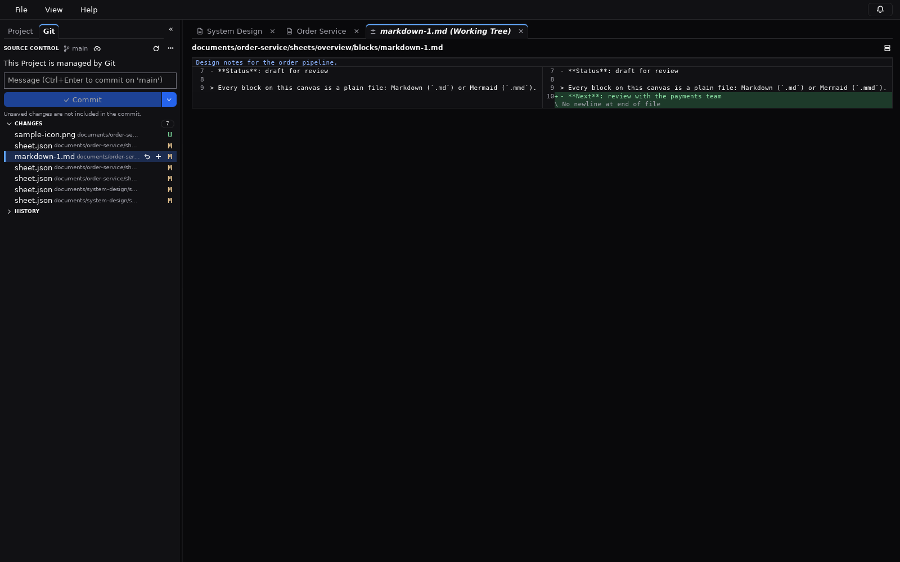
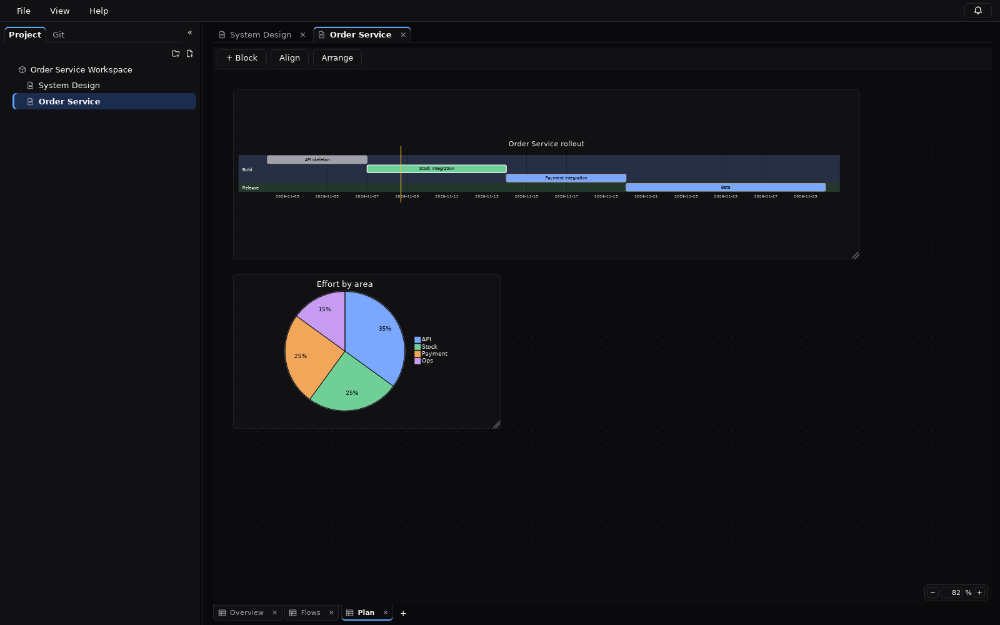
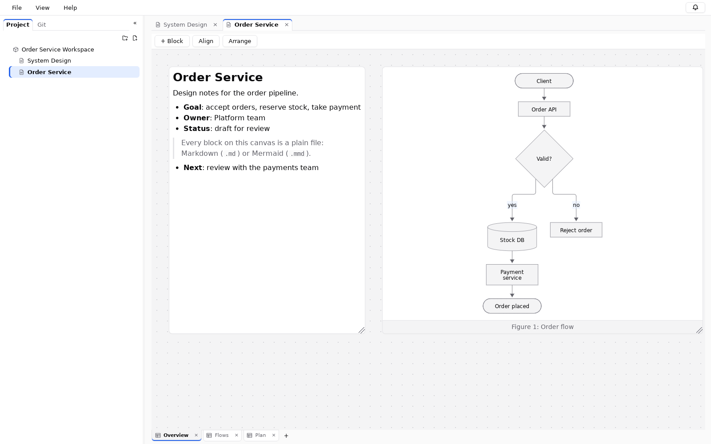

# Design Dawn

[English](README.md) | **日本語**

Design Dawn は、ブロックを自由に配置できるキャンバスの上で設計ドキュメントを書くためのデスクトップアプリケーションです。
ドキュメントは複数のシートからなり、各シートに **Markdown**・**Mermaid の図**・**画像** のブロックを自由に配置できます。
すべてが通常のファイルとフォルダとして保存されるため、人が読み書きでき、Git でレビューでき、AI ツールも安全に変更できます。



> **状態**: 公開前の開発版です。Linux（WSL2 + WSLg）で開発・確認しています。Windows・macOS 向けのビルドはまだ確認していません。

## 機能

- **自由配置キャンバス** — パン・ズーム・選択・移動・リサイズ・整列・重なり順・コピー / 貼り付け。すべての編集を元に戻せます（Undo / Redo）。
- **Project → Document → Sheet → Block** — フォルダつきの Project ツリー、Document タブ、Sheet タブ。複数の Document（と複数のウィンドウ）を同時に開けます。
- **Markdown ブロック** — キャンバス上では表示結果、編集中はソースとプレビューの分割表示。
- **Mermaid ブロック** — Mermaid 12 のすべての図を、ローカルで描画・サニタイズして表示します（ネットワーク・スクリプトなし）。
- **Mermaid の GUI 編集** — 円グラフ・フローチャート・シーケンス図・ガントチャートを、構文を書かずに一覧とプロパティ欄で編集できます。正本は Mermaid のソースのままで、GUI の1回の操作は必要な部分だけを書き換え、結果を読み直して描画できることを確かめてから確定し、Undo 1回で戻せます。完全に理解できない構文を含む図は、書き換えずに読み取り専用にします。
- **画像ブロック** — PNG・JPEG・WebP・SVG・GIF をドラッグ & ドロップで追加。
- **Git 連携** — 状態・ステージ / 解除・コミット・履歴・タブで開く左右比較の差分・変更の破棄・フェッチ / プル / プッシュ・ブランチ表示。
- **外部変更の検知** — 他のエディタ・Git・AI ツールによる変更を検知します。未保存の変更が無い Document は自動で読み直し、ある場合は「読み直す / 今の内容を維持 / 比較」から選べます。
- **AI / MCP** — `design-dawn-mcp`：Claude Code などの AI クライアントが Document・Sheet・Block を読み書きできるローカルの MCP サーバー（標準入出力のみ、既定は読み取り専用）。
- **読み込み時の問題の修復と形式の移行** — Project を開いたときに見つかった不整合（一覧に無い / 存在しない項目、ID の重複、使われていないファイル、中断した保存の残り）を通知パネルから修復できます。古い版で書かれたファイルは読み込み時に変換し、次の保存で新しい形式になります。
- **ライト / ダークのテーマ**、**英語 / 日本語** の表示。上部は「ファイル / 表示 / ヘルプ」のメニューバーにまとめています（バージョンとライセンスはヘルプから確認できます）。

| フローチャートの GUI 編集 | シーケンス図の GUI 編集 |
|---|---|
|  |  |

| Markdown の編集 | Git の差分 |
|---|---|
|  |  |

| ガントチャートと円グラフ | ライトテーマ |
|---|---|
|  |  |

## Project の保存形式

```text
my-project/
├── project.json                  # Project 名と Document の順序
├── system-design.dawn            # ファイルマネージャーから Document を開く入口
└── documents/
    └── system-design/
        ├── document.json         # Sheet の順序
        ├── assets/               # 画像
        └── sheets/
            └── overview/
                ├── sheet.json    # Block の位置・大きさ・種類
                └── blocks/
                    ├── markdown-1.md
                    └── mermaid-1.mmd
```

配置は小さな JSON に、内容は `.md` / `.mmd` に分けて保存するため、差分が読みやすく、人や AI が他の部分に触れずに1つの Block だけを変更できます。
すべての JSON ファイルは `schemaVersion` を持ち、ID は変わらない UUID、表示名はフォルダ名と独立しています。

## ビルドと実行

開発はすべて開発コンテナの中で行います。ホストに必要なのは Docker だけです。

**前提**: Linux、または WSL2（WSLg 有効）を使う Windows 11 と Docker（Windows では WSL2 バックエンドの Docker Desktop）。リポジトリは Linux / WSL2 側のファイルシステムに clone してください。

```sh
docker compose build                 # 開発用イメージを作る
docker compose up -d                 # 開発コンテナを起動
docker compose exec dev npm ci       # 依存をインストール
docker compose exec dev npm run tauri dev   # アプリを起動（ウィンドウは WSLg / X11 で表示）
```

その他のコマンド:

```sh
docker compose exec dev npm run verify   # 型チェック・Biome・Vitest・ライセンス検査・cargo fmt / clippy / test
docker compose exec dev npm run build    # フロントエンドの本番ビルド
docker compose exec dev npm run tauri build -- --bundles deb   # Linux のパッケージ
```

注意:

- `node_modules` と Rust のビルド出力は Docker の名前付きボリュームに置き、ソースツリーには入れません。
- ウィンドウは WSLg の X11 で表示します（`compose.yaml` の `GDK_BACKEND=x11`）。
- リポジトリを Windows のドライブからマウントしている場合は、ファイル変更の通知が届かないことがあるため `DAWN_WATCH_POLLING=true` を設定してください。

## AI（MCP）から使う

```sh
docker compose exec dev cargo build --release --manifest-path src-tauri/Cargo.toml --bin design-dawn-mcp
claude mcp add design-dawn -- /path/to/design-dawn-mcp --project /path/to/my-project
```

標準入出力だけで MCP を話し、アプリが起動していなくても使えます。

- **読み取り**: `getProject`、`getDocument`、`getSheet`、`getBlock`。
- **書き込み**（`--allow-write` のときだけ）: `createDocument`、`createSheet`、`createBlock`（Markdown / Mermaid）、`updateDocument`、`updateSheet`、`updateBlock`、`moveBlock`、`deleteBlock`。
- Block の本文を変えるときは、`getBlock` で読んだ `contentHash` を `expectedContentHash` として渡します。その間に本文が変わっていれば `conflict` が返ります。
- Document・Sheet・Project の削除、ディスク上のファイルの取り込み、コマンドの実行、Git の操作、ネットワーク接続はできません。アプリがその Project を開いていれば、変更は外部変更として取り込まれます。

Claude Desktop（`claude_desktop_config.json`）:

```json
{
  "mcpServers": {
    "design-dawn": {
      "command": "/path/to/design-dawn-mcp",
      "args": ["--project", "/path/to/my-project"]
    }
  }
}
```

## ライセンス

Design Dawn は [MIT License](LICENSE) で公開しています。同梱している依存ライブラリの第三者ライセンスは [`THIRD_PARTY_NOTICES.md`](THIRD_PARTY_NOTICES.md) に記載しています。
