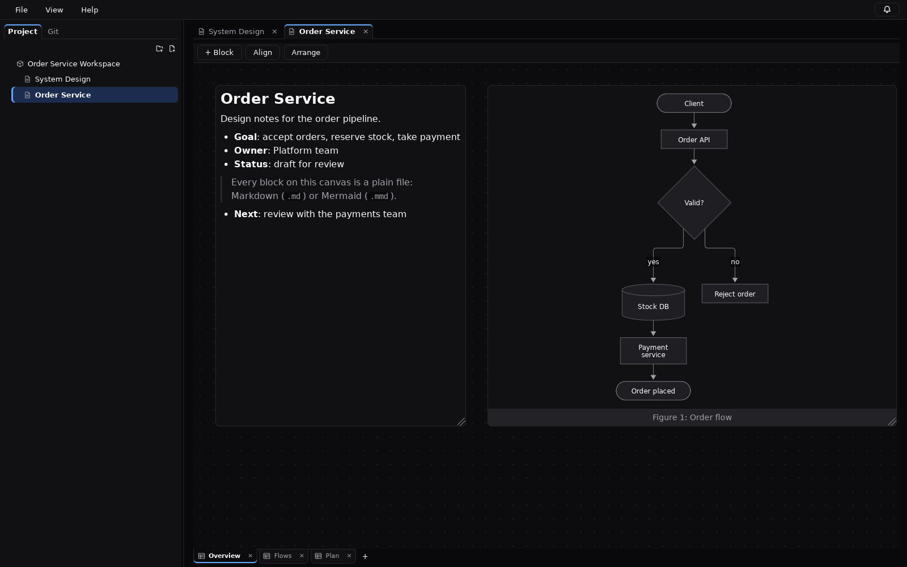
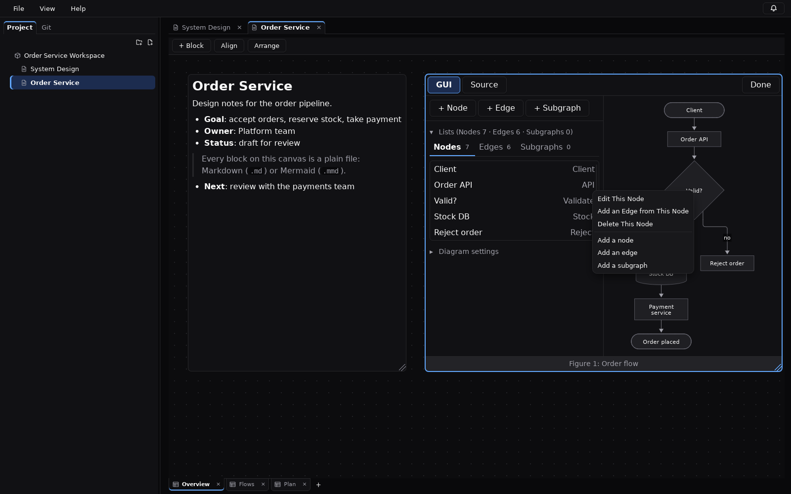
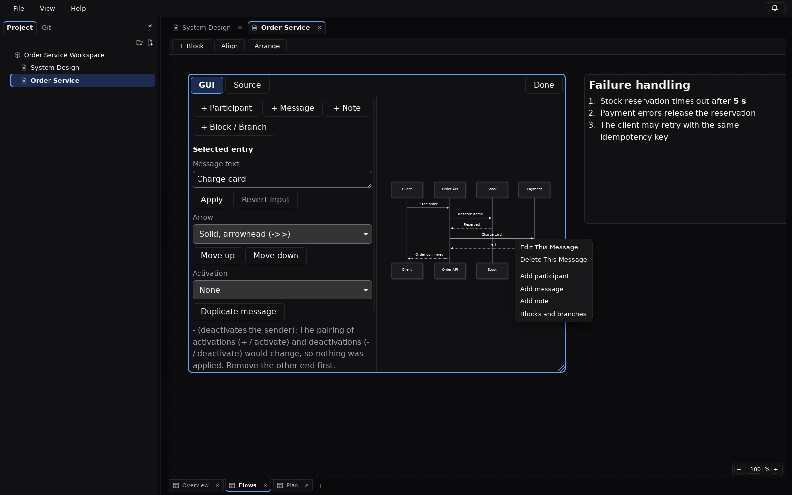
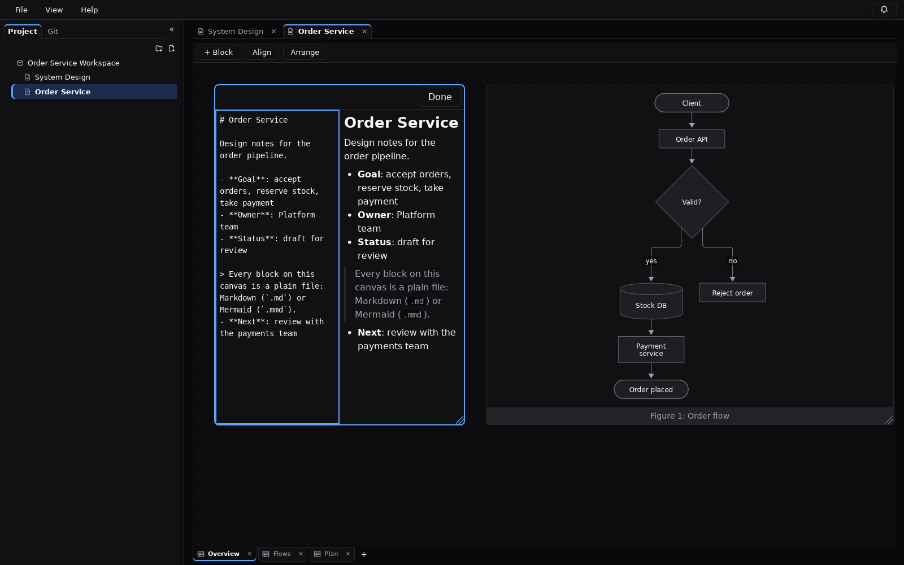
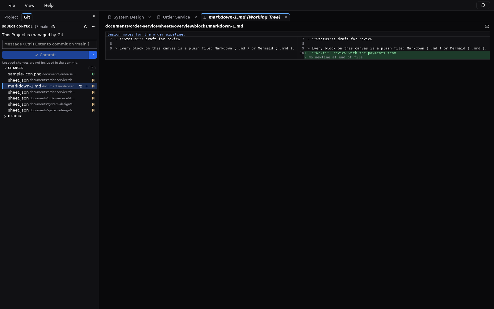
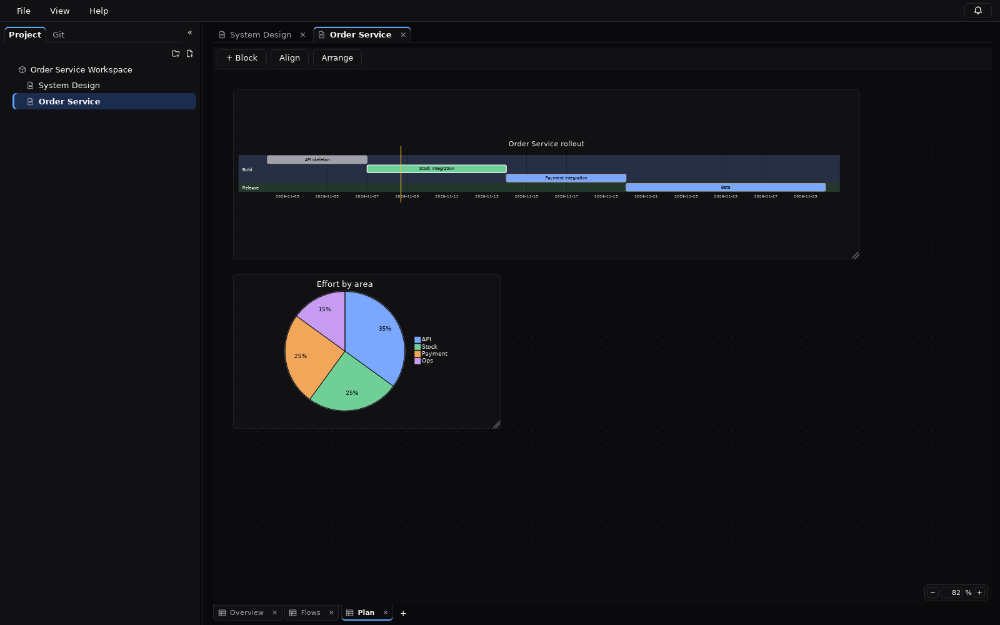
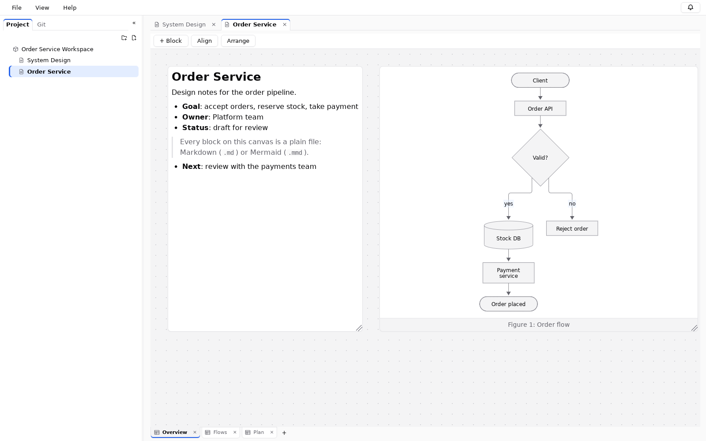
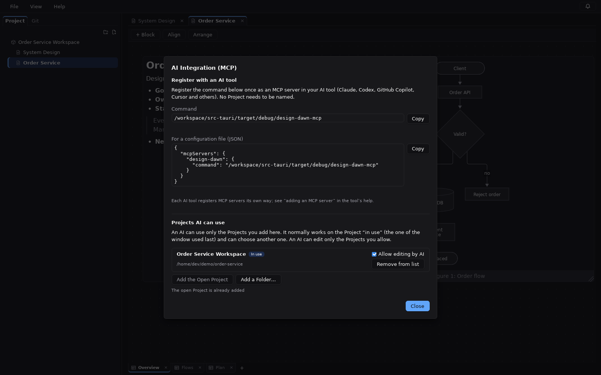
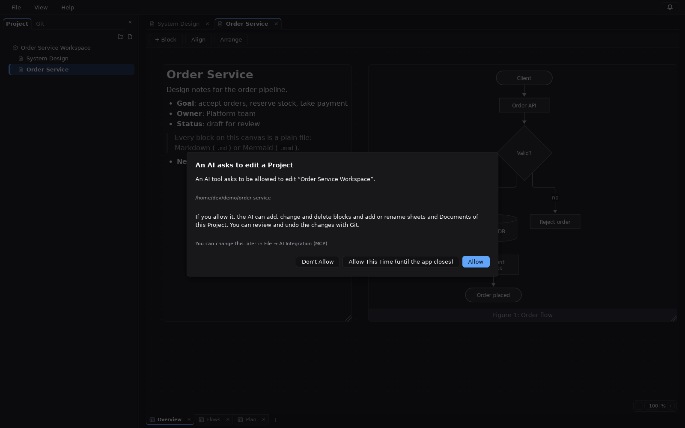

# Design Dawn — free-form canvas for design documents with Markdown and Mermaid

**English** | [日本語](README.ja.md) · [Website](https://pg-refactor.github.io/Design-Dawn/)

[](LICENSE)
[](https://github.com/PG-Refactor/Design-Dawn/releases/latest)


**Design Dawn** is a free, open-source desktop app (Tauri 2, Rust + TypeScript) for writing
software design documents on a free-form canvas: a **Markdown editor**, a **Mermaid diagram editor**
with a GUI, and image blocks on the same sheet, saved as Git-friendly plain files (docs as code), with
an **MCP server** so AI tools such as Claude, Codex, GitHub Copilot and Cursor can read and edit them.

A document is a set of sheets; each sheet holds freely placed blocks of **Markdown**, **Mermaid
diagrams** and **images**. Everything is stored as ordinary files and folders, so the same project
can be read and edited by people, reviewed with Git, and changed safely by AI tools.



## Features

- **Free-form canvas** — pan, zoom (wheel, or the zoom control in the corner: - / + or a typed
  percentage), select, move, resize, align, z-order, copy/paste, and undo/redo for every edit.
- **Project → Document → Sheet → Block** — a project tree with folders (drag rows to reorder or
  move them), document tabs and sheet tabs; several documents (and windows) open at once. The
  sidebar can be folded away.
- **Markdown blocks** — rendered view on the canvas; a split source/preview editor while editing
  (the divider moves, and the preview can be hidden; the same for Mermaid source).
- **Mermaid blocks** — any Mermaid 12 diagram, rendered locally and sanitised (no network, no
  scripts).
- **Mermaid GUI editor** — edit pie charts, flowcharts, sequence diagrams and Gantt charts with
  lists and property fields instead of syntax; right-click a shape in the diagram to edit or
  delete it, and add elements in a dialog with a preview. The Mermaid source stays the single
  source of truth: each GUI edit changes only the bytes it must, is checked by re-reading the
  result and rendering it, and is one undo step. Anything the editor does not fully understand
  stays read-only rather than being rewritten.
- **Image blocks** — PNG, JPEG, WebP, SVG and GIF, added by drag and drop or from a file dialog.
- **Captions** — diagrams and images can have a one-line caption above or below them.
- **Git integration** — status, stage/unstage, commit, history, side-by-side diffs in tabs,
  discard, fetch/pull/push, branch display.
- **External changes** — edits made by another editor, Git or an AI tool are detected; documents
  without unsaved work reload automatically, otherwise you choose to reload, keep your version or
  compare.
- **AI / MCP** — `design-dawn-mcp`, a local MCP server (stdio only) that lets AI tools such as
  Claude, Codex, GitHub Copilot or Cursor read and edit the projects you offer to them. Every
  project is read-only for AI until you allow editing, in the app or when the AI asks.
- **Load issue repair and format migration** — inconsistencies found when a project is opened
  (missing or unlisted items, duplicate IDs, orphan files, leftovers of an interrupted save) can be
  repaired from the notification panel; files written by older versions are read and upgraded on
  the next save.
- **Light / dark theme** and **English / Japanese** UI, with a compact File / View / Help menu bar
  (version and license information under Help).

| Flowchart GUI editor | Sequence diagram GUI editor |
|---|---|
|  |  |

| Markdown editing | Git diff |
|---|---|
|  |  |

| Gantt and pie charts | Light theme |
|---|---|
|  |  |

| AI integration (MCP) | An AI asks for edit permission |
|---|---|
|  |  |

## Why Design Dawn

- **Not a long scroll, not a whiteboard file** — arrange notes, diagrams and screenshots side by
  side like a whiteboard, but keep every block as a `.md` or `.mmd` file you can diff and review in
  a pull request.
- **Mermaid without memorising syntax** — edit flowcharts, sequence diagrams and Gantt charts in a
  GUI while the Mermaid source stays the source of truth.
- **Safe for AI agents** — AI tools work through a local MCP server, read-only until you allow
  editing, with conflict detection instead of silent overwrites.
- **Offline and local** — no account, no cloud, no network access for rendering.

Typical uses: architecture and system design docs, API and sequence flows, ADRs with diagrams,
project plans with Gantt charts, and design reviews in Git.

## How a project is stored

```text
my-project/
├── project.json                  # project name and document order
├── system-design.dawn            # entry point that opens a document from the file manager
└── documents/
    └── system-design/
        ├── document.json         # sheet order
        ├── assets/               # images
        └── sheets/
            └── overview/
                ├── sheet.json    # block positions, sizes and types
                └── blocks/
                    ├── markdown-1.md
                    └── mermaid-1.mmd
```

Layout lives in small JSON files and content lives in `.md` / `.mmd` files, so diffs stay readable
and a human or an AI can change one block without touching the rest. Every JSON file carries a
`schemaVersion`; IDs are stable UUIDs, and display names are independent of folder names.

## Building and running

Development happens entirely inside a dev container; nothing but Docker is needed on the host.

**Prerequisites**: Linux, or Windows 11 with WSL2 (WSLg enabled), and Docker (Docker Desktop with
the WSL2 backend on Windows). Clone the repository onto the Linux / WSL2 file system.

```sh
docker compose build                 # build the dev image
docker compose up -d                 # start the dev container
docker compose exec dev npm ci       # install dependencies
docker compose exec dev npm run tauri dev   # run the app; the window appears through WSLg / X11
```

Other commands:

```sh
docker compose exec dev npm run verify   # typecheck, Biome, Vitest, license check, cargo fmt/clippy/test
docker compose exec dev npm run build    # frontend production build
docker compose exec dev npm run tauri build -- --bundles deb   # Linux package
docker compose exec dev npm run tauri:build:windows   # Windows .exe (cross-built, no installer)
```

Notes:

- `node_modules` and the Rust build output live on Docker named volumes, not in the source tree.
- The window is shown through WSLg X11 (`GDK_BACKEND=x11` in `compose.yaml`).
- `tauri:build:windows` cross-builds `design-dawn.exe` and `design-dawn-mcp.exe` into
  `src-tauri/target/x86_64-pc-windows-msvc/release/` with
  [cargo-xwin](https://github.com/rust-cross/cargo-xwin). On first use it downloads the Microsoft
  CRT and Windows SDK (about 1 GB, under Microsoft's license) into a Docker volume. Copy the
  `.exe` anywhere on Windows and run it; it needs the WebView2 runtime, which Windows 11 includes.
  Tauri calls this way of building experimental, so build installers for distribution on Windows
  (see [Building a Windows installer](#building-a-windows-installer)).
- If the repository is bind-mounted from a Windows drive, set `DAWN_WATCH_POLLING=true`, because
  file change events may not arrive there.

## Building a Windows installer

Installers are built on Windows itself (the dev container cross-builds only the `.exe` files).
They are not code-signed for now.

**Prerequisites** (on Windows):

- [Microsoft C++ Build Tools](https://visualstudio.microsoft.com/visual-cpp-build-tools/) with the
  "Desktop development with C++" workload
- [Rust](https://rustup.rs/) with the MSVC toolchain (the version in `rust-toolchain.toml` is
  installed automatically on first build)
- [Node.js](https://nodejs.org/) 24 or later
- WebView2 runtime (included in Windows 11)

**Build** (PowerShell, in a clone of the repository):

```powershell
npm ci
npm run tauri build                                                   # installers for the app
cargo build --release --manifest-path src-tauri/Cargo.toml --bin design-dawn-mcp   # MCP server
```

Results:

- `src-tauri\target\release\bundle\nsis\Design Dawn_<version>_x64-setup.exe`: NSIS installer
- `src-tauri\target\release\bundle\msi\Design Dawn_<version>_x64_en-US.msi`: MSI installer
- `src-tauri\target\release\design-dawn-mcp.exe`: the MCP server. The installers do not include it
  yet; put it next to the installed `design-dawn.exe` (where the AI Integration screen looks for
  it) and register that path with the AI tool (see below).

Tauri downloads NSIS and WiX on the first build. `npm run tauri build -- --bundles nsis` builds only
the NSIS installer.

**Unsigned builds**: Windows SmartScreen warns when an unsigned installer is started ("Windows
protected your PC"). Choose "More info", then "Run anyway". Only do this for installers you built
yourself or got from a source you trust.

## Using it with AI (MCP)

`design-dawn-mcp` is a local MCP server that lets an AI tool (Claude, Codex, GitHub Copilot,
Cursor or any other MCP client) read and edit Design Dawn projects. It speaks MCP over
stdin/stdout only, opens no network port, and works whether or not the app is running.

**Set-up (once per AI tool)**: in the app, open **File → AI Integration (MCP)**. It shows the
command to register (the `design-dawn-mcp` next to the app) with a Copy button, and the same as
the common JSON form:

```json
{
  "mcpServers": {
    "design-dawn": { "command": "C:\\path\\to\\design-dawn-mcp.exe" }
  }
}
```

Register it the way your AI tool adds MCP servers (for Claude Code:
`claude mcp add design-dawn -- <command>`). No project is named in the registration.

**Which projects the AI may use**: only the ones you add in the AI Integration screen (**Add
the Open Project**, or **Add a Folder…** for any project folder). By default the AI works on the
project open in the app (the window used last; the last one used when the app is closed), if it
is added. The AI can list the added projects (`listProjects`) and choose one (`selectProject`),
so "summarize the order-service project" works without registering anything again.

**Permissions**: an added project is read-only for AI until you tick **Allow editing by AI**
next to it. An AI can also ask (`requestWriteAccess`): the app then asks you to **Allow**,
**Allow This Time** (until the app closes) or **Don't Allow**, and only your answer counts. The
project open in the app can be asked for too; allowing it adds it to the list. After a "no",
requests for that project are ignored for a while. Only the app changes this list (it is kept in
the app's settings folder as `ai-access.json`, never inside a project), so an AI cannot add a
project or grant itself access. The screen also removes a project from the list.

- **Tools**: `listProjects`, `selectProject`, `requestWriteAccess`, `getProject`, `getDocument`,
  `getSheet`, `getBlock`; for writable projects also `createDocument`, `createSheet`, `createBlock` (Markdown or Mermaid),
  `updateDocument`, `updateSheet`, `updateBlock`, `moveBlock`, `updateBlockCaption` (the caption
  of a Mermaid or Image block), `deleteBlock`.
- To change a block's text, the AI reads it with `getBlock` and passes its `contentHash` as
  `expectedContentHash`; if the text changed in the meantime the call returns `conflict`.
- It cannot delete documents, sheets or projects, import files from disk, run commands, use Git or
  open network connections. If the app has the project open, it shows the changes at once.

**One fixed project** (without the app's list): start it with
`--project <folder holding project.json>`, and add `--allow-write` to allow changes:

```sh
claude mcp add design-dawn -- /path/to/design-dawn-mcp --project /path/to/my-project
```

To build only the server: `cargo build --release --manifest-path src-tauri/Cargo.toml --bin design-dawn-mcp`.

## License

Design Dawn is released under the [MIT License](LICENSE). Third-party licenses of the bundled
dependencies are listed in [`THIRD_PARTY_NOTICES.md`](THIRD_PARTY_NOTICES.md).
